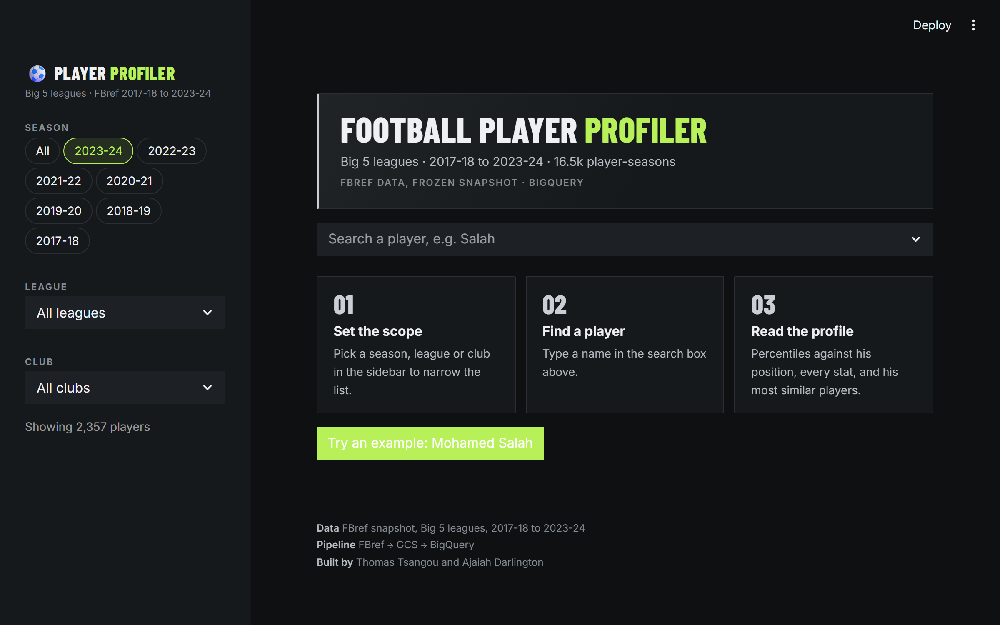
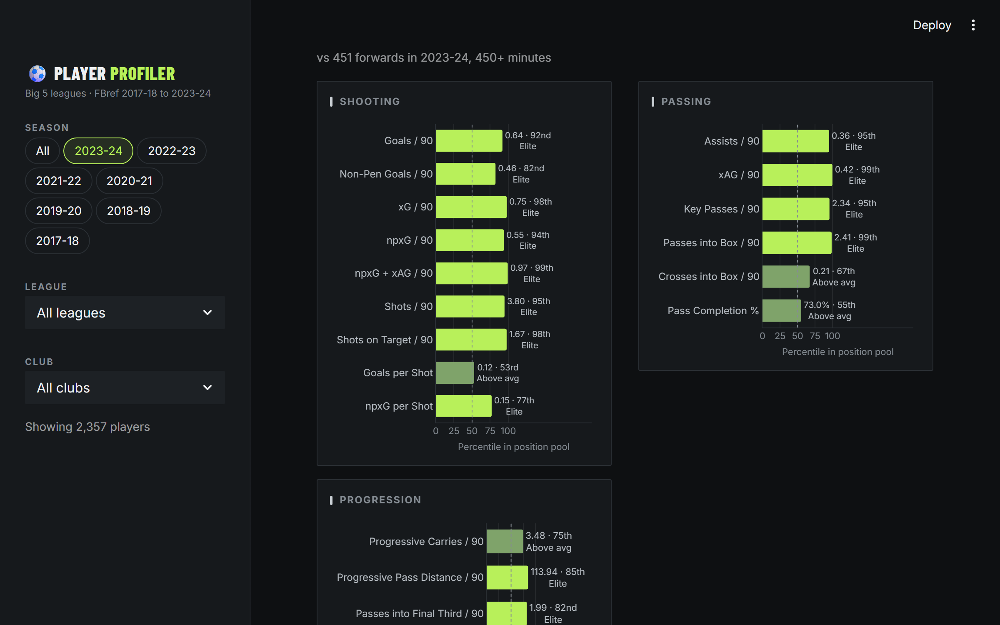
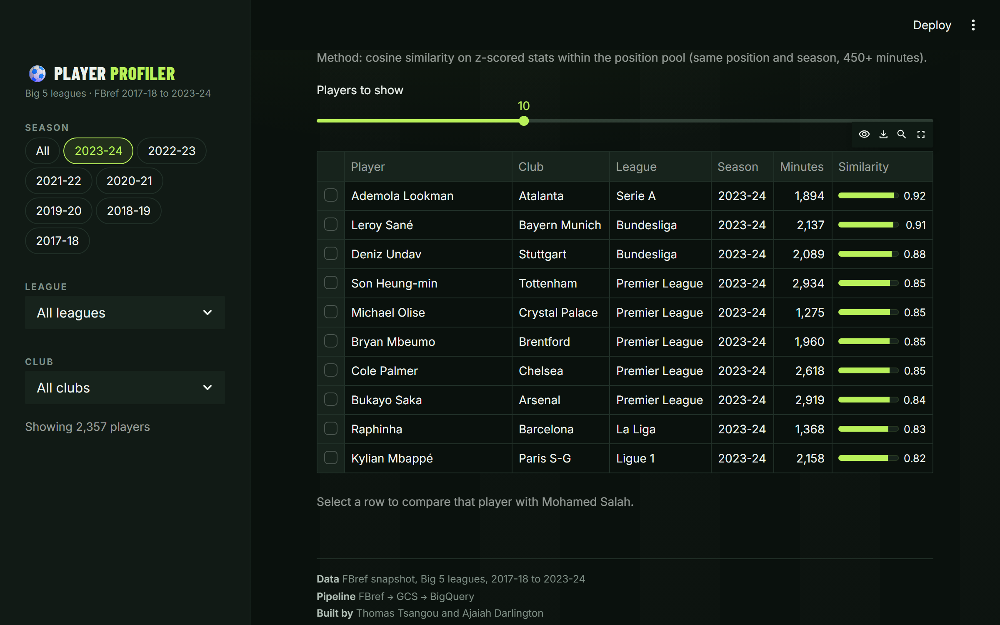
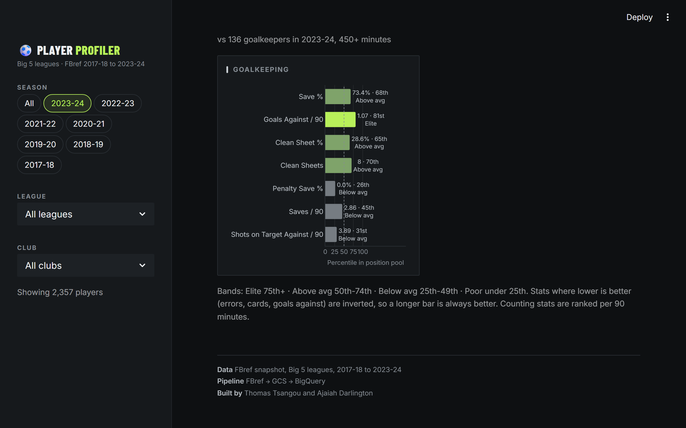

# Scouting Hub

An end-to-end football analytics platform built on a professional GCP data stack. Covers 7 seasons (2017–2024) of player statistics across Europe's Big 5 leagues, with a player similarity model and an interactive Streamlit scouting app backed by BigQuery.

---

## What it does

- **Scrapes and cleans** player statistics from FBref across 5 stat categories (standard, shooting, passing, defending, goalkeeping)
- **Loads data** into Google Cloud Storage and BigQuery via an automated ETL pipeline
- **Computes similarity** between players using position-aware cosine similarity on z-scored stats
- **Visualises** player percentile rankings and similar players through a Streamlit app that queries BigQuery live

---

## Architecture

```
FBref (HTML/CSV)
      │
      ▼
run_cleaning.py  ──  src/fbref_utils.py
(clean, normalise, aggregate transfers)
      │
      ▼
cleaned_data/*.xlsx
      │
      ▼
gcp_loader.py
├── Upload to GCS (parquet)
└── Load into BigQuery
          │
          ▼
    BigQuery: scouting dataset
    ├── Layer 1: raw tables (standard, shooting, passing, defending, goalkeeping)
    ├── Layer 2: feature tables (outfield_features, goalkeeper_features)
    └── Layer 3: percentile views (attacker, midfielder, defender, goalkeeper)
          │
          ▼
       app.py  (Streamlit, runs locally, queries BigQuery)
```

---

## Data

| Source | FBref.com |
|--------|-----------|
| Seasons | 2017-18 through 2023-24 |
| Leagues | Premier League, La Liga, Serie A, Bundesliga, Ligue 1 |
| Tables | Standard, Shooting, Passing, Defending, Goalkeeping |
| Records | 16,532 player-seasons with 90+ minutes in BigQuery (15,184 outfield + 1,348 goalkeeper); 13,773 with 450+ minutes, the cut-off used for percentiles and similarity |

---

## Key engineering decisions

**Transfer aggregation** — Mid-season transfers create duplicate player-season rows in FBref (one per club). The cleaning pipeline detects these and aggregates them: counting stats are summed, per-90 rates are recalculated from aggregated totals, and identity columns are taken from the spell with the most minutes. This runs automatically for all five stat categories with table-specific rules.

**Name normalisation** — Different FBref stat tables use slightly different name spellings (transliterations, middle names, name changes). A fuzzy-matching pass within each (Season, Squad) group at similarity ≥ 0.60 resolves these. Constraining to the same squad makes false positives extremely unlikely.

**GK data** — Goalkeeper stats are sourced from raw HTML (not CSV) because FBref's HTML export contains duplicate column names that require multi-level flattening. The pipeline handles this automatically.

**Join key** — Tables are joined on `(Player, Season)` rather than `(Player, Season, Squad)` because loan players can appear under different club names across stat categories. Nine remaining orphan rows are a known limitation of this approach.

**Parameterised queries** — All BigQuery queries use `@parameter` syntax rather than f-string interpolation, guarding against query breakage on player names containing apostrophes (e.g. O'Brien).

---

## Similarity model

Defined in `src/similarity.py`. Uses cosine similarity on z-scored stats.

1. Players are grouped into four pools by primary position: ATT, MID, DEF, GK
2. Each pool has a curated feature template (15 stats for outfield, 5 for GK) mixing per-90 and rate metrics with a few season totals (key passes, progressive carries, passes into the box)
3. Feature columns are z-scored across the pool so no single stat dominates by scale
4. Cosine similarity is computed between the query player and every other player in the same pool
5. Results are returned ranked by similarity score, filtered to players with ≥ 450 minutes

**Known limitation:** With FBref data, goals and assists naturally carry high signal weight. More granular tracking data (pressing, spatial, ball retention) would improve result quality.

---

## App

`app.py` runs **Scouting Hub**, a Streamlit app that queries BigQuery live (results are cached for an hour).

- Sidebar filters: season (or all seasons), league and club
- Search for one player. Players with several seasons in view get a season switcher.
- Identity card with headline numbers: goals, assists, xG and xAG, or save %, goals against per 90 and clean-sheet % for keepers
- **Profile**: percentile bars against the same position and season (450+ minutes) on a curated metric list per position. Lower-is-better stats (errors, cards, goals against) are inverted. Counting stats are ranked per 90 minutes.
- **Stats**: every stat by category, with the season total next to per 90
- **Similar players**: the similarity model's top matches. Select one to compare percentiles side by side and jump to their profile.

UI code lives in `src/ui/`: theme, charts, cached queries and views. Per-position metric lists, labels and number formats are all in `src/ui/metrics.py`, the one file to edit when the data source changes.

### Screenshots






---

## Setup

**Requirements**

```bash
.venv/Scripts/pip install -r requirements.txt
```

**GCP authentication**

```bash
gcloud auth application-default login
```

**Configure project**

Edit the two config lines at the top of `gcp_loader.py` and `src/similarity.py`:

```python
GCP_PROJECT = "your-project-id"
GCS_BUCKET  = "your-bucket-name"
```

**Run the cleaning pipeline**

```bash
.venv/Scripts/python run_cleaning.py
```

**Load data into GCP**

```bash
.venv/Scripts/python gcp_loader.py
```

**Start the app**

```bash
.venv/Scripts/python -m streamlit run app.py
```

**Run the tests** (no BigQuery needed: the data layer is stubbed)

```bash
.venv/Scripts/python -m pip install -r requirements-dev.txt
.venv/Scripts/python -m pytest
```

**Refresh the README screenshots** (needs the app running on port 8599 and Playwright: `pip install playwright && playwright install chromium`)

```bash
.venv/Scripts/python -m streamlit run app.py --server.headless true --server.port 8599
python scripts/screenshot.py
```

---

## Project structure

```
scouting-report/
├── run_cleaning.py          # Pipeline entry point — cleans all datasets
├── gcp_loader.py            # Uploads to GCS, loads into BigQuery, rebuilds feature tables
├── app.py                   # Streamlit app shell (Scouting Hub)
├── schema.sql               # Full BigQuery DDL (raw tables + feature tables + percentile views)
├── requirements.txt
├── requirements-dev.txt     # + pytest
├── .streamlit/config.toml   # Charcoal theme (lime accent) for native widgets
├── src/
│   ├── fbref_utils.py       # All cleaning, normalisation, and aggregation logic
│   ├── similarity.py        # Similarity model and BigQuery query functions
│   └── ui/                  # theme, charts, metric config, cached queries, views
├── tests/                   # pytest + Streamlit AppTest (BigQuery stubbed)
├── scripts/screenshot.py    # Playwright review screenshots
├── docs/screenshots/        # README images
├── cleaned_data/            # Output of run_cleaning.py (gitignored)
├── uncleaned_data_csv/      # Raw FBref CSV exports (gitignored)
└── data_html/               # Raw FBref HTML files for goalkeeping (gitignored)
```

---

## Stack

| Layer | Technology |
|-------|------------|
| Data lake | Google Cloud Storage |
| Data warehouse | BigQuery |
| ETL | Python (pandas, pyarrow) |
| Similarity model | NumPy (cosine similarity) |
| App | Streamlit |
| Charts | Plotly |
| Tests | pytest, Streamlit AppTest |
| Auth | GCP Application Default Credentials |
| Packaging | Docker (`Dockerfile`, `docker-compose.yml`) |

---

## Contributors

Thomas Tsangou and Ajaiah Darlington.
