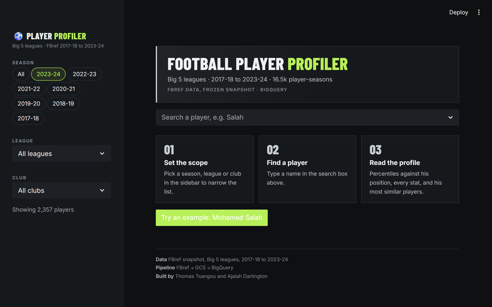
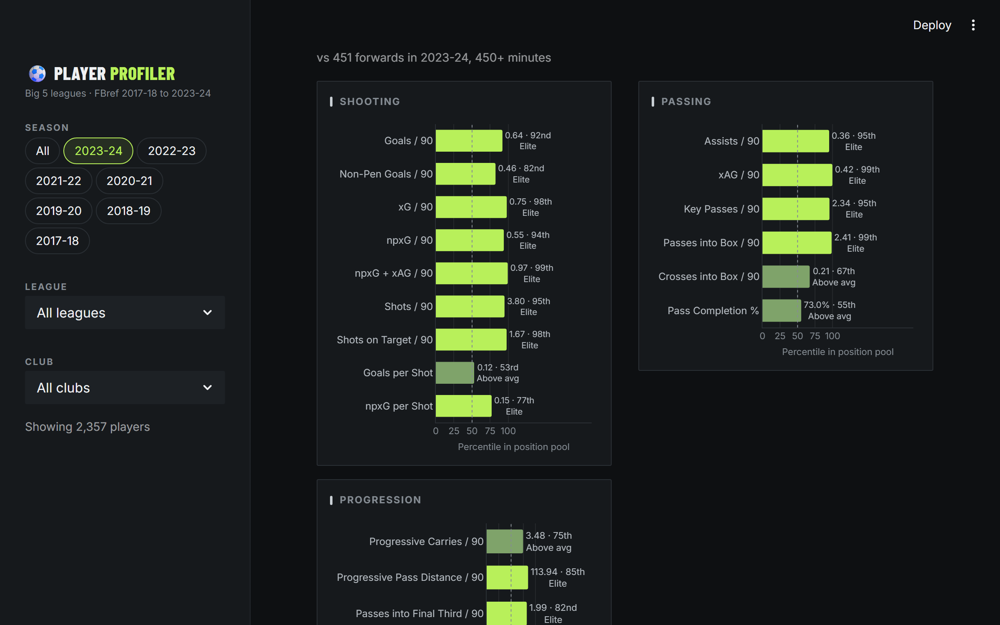
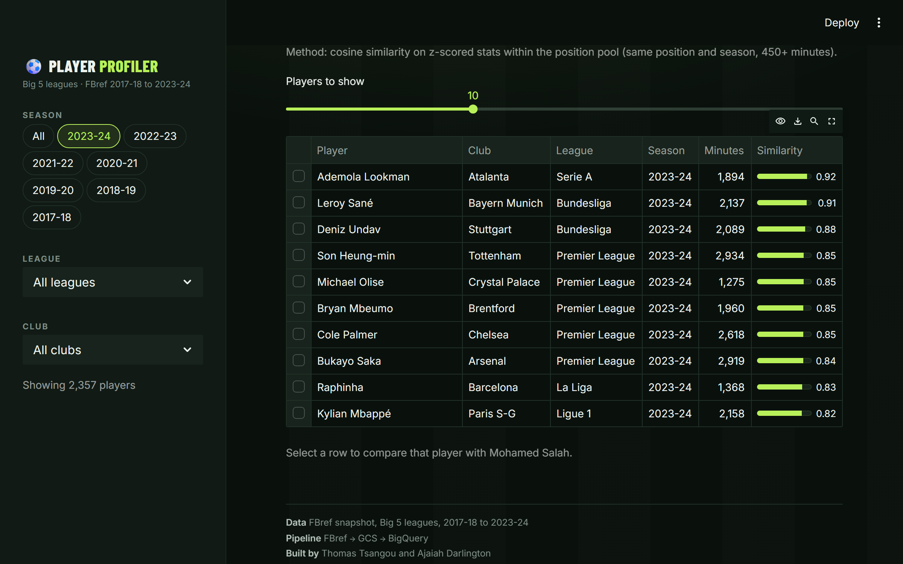
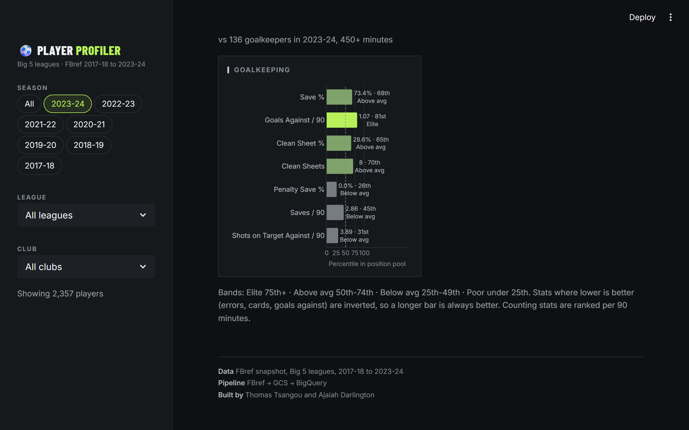

# Scouting Hub

An end-to-end football analytics platform built on a professional GCP data stack. Covers player statistics across 19 leagues: Europe's Big 5 from 2017-18 (FBref), 15 European leagues for 2024-25 and 2025-26, and four US leagues for 2024 to 2026. It has a player similarity model and an interactive Streamlit scouting app backed by BigQuery.

---

## What it does

- **Scrapes and cleans** player statistics from FBref across 5 stat categories (standard, shooting, passing, defending, goalkeeping)
- **Loads data** into Google Cloud Storage and BigQuery via an automated ETL pipeline
- **Computes similarity** between players using position-aware cosine similarity on z-scored stats
- **Visualises** player percentile rankings and similar players through a Streamlit app that queries BigQuery live

---

## Architecture

```
FBref (HTML/CSV)
      │
      ▼
run_cleaning.py  ──  src/fbref_utils.py
(clean, normalise, aggregate transfers)
      │
      ▼
cleaned_data/*.xlsx
      │
      ▼
gcp_loader.py
├── Upload to GCS (parquet)
└── Load into BigQuery
          │
          ▼
    BigQuery: scouting dataset
    ├── Layer 1: raw tables (standard, shooting, passing, defending, goalkeeping)
    ├── Layer 2: feature tables (outfield_features, goalkeeper_features)
    └── Layer 3: percentile views (attacker, midfielder, defender, goalkeeper)
          │
          ▼
       app.py  (Streamlit, runs locally, queries BigQuery)
```

---

## Data

The app reads two BigQuery views, `outfield_all` and `goalkeeper_all`. Each one unions the original FBref feature table with a newer table loaded from the soccer-data warehouse (`outfield_features_v2`, `goalkeeper_features_v2`, written by `scripts/load_soccer_data.py`) and adds a `Source` column, shown as a chip on every player card. The FBref tables are never modified. New seasons never overlap FBref seasons, so a similarity or percentile pool never mixes the two.

| Seasons | Leagues | Source |
|---------|---------|--------|
| 2017-18 to 2023-24 | Premier League, La Liga, Serie A, Bundesliga, Ligue 1 | FBref (frozen snapshot: standard, shooting, passing, defending, goalkeeping) |
| 2024-25, 2025-26 | Big 5 | API-Football, with xG from Understat |
| 2024-25, 2025-26 | Championship, League One, League Two, Primeira Liga, Eredivisie, Belgian Pro League, Austrian Bundesliga, Swiss Super League, Danish Superliga, Scottish Premiership | API-Football (season totals; for some leagues, totals built from match data) |
| 2024, 2025, 2026 | MLS, USL Championship, USL League One, MLS NEXT Pro | American Soccer Analysis |

European seasons are labelled `2025-2026` (shown as 2025-26) and US calendar seasons `2026`. The FBref part holds 16,532 player-seasons with 90+ minutes (15,184 outfield + 1,348 goalkeeper); 13,773 have 450+ minutes, the cut-off used for percentiles and similarity.

**What the newer sources add.** Metrics FBref never had, empty for 2017-18 to 2023-24:

- API-Football (all European leagues): appearances, starts, average match rating, duels and duels won %, dribbles attempted and completed, dribble success %, dribbled past, fouls drawn and committed, penalties won, conceded and missed, offsides.
- Understat (Big 5): xG Chain and xG Buildup.
- American Soccer Analysis (US leagues): goals added, in total, above average and by action (shooting, passing, receiving, dribbling, defending, fouling), passes completed over expected (total and per 100 passes), expected pass completion %, share of team touches, average pass distance and average vertical pass distance.

**What the newer sources lack.** Stats a source doesn't have are left empty, never filled with zeros:

- No progressive passing or carries after 2023-24, and none of FBref's other detailed passing, possession and defensive-action splits.
- US leagues have no tackles, interceptions, duels or dribbles, and no goalkeeper stats (American Soccer Analysis keepers are not loaded).
- In Europe only the Big 5 have xG (from Understat); the other ten European leagues have none in 2024-25 or 2025-26.
- Goalkeepers after 2023-24 have no penalty save %.

Stats are grouped the same way for every season: Shooting, Chance creation, Passing, Possession and dribbling, Defending, Duels, Goals added, Discipline, Playing time and Goalkeeping. The similarity model and the Profile tab work on the stats a player-season has (see below), and the Stats tab simply shows the cards and rows it has.

---

## Key engineering decisions

**Transfer aggregation** — Mid-season transfers create duplicate player-season rows in FBref (one per club). The cleaning pipeline detects these and aggregates them: counting stats are summed, per-90 rates are recalculated from aggregated totals, and identity columns are taken from the spell with the most minutes. This runs automatically for all five stat categories with table-specific rules.

**Name normalisation** — Different FBref stat tables use slightly different name spellings (transliterations, middle names, name changes). A fuzzy-matching pass within each (Season, Squad) group at similarity ≥ 0.60 resolves these. Constraining to the same squad makes false positives extremely unlikely.

**GK data** — Goalkeeper stats are sourced from raw HTML (not CSV) because FBref's HTML export contains duplicate column names that require multi-level flattening. The pipeline handles this automatically.

**Join key** — Tables are joined on `(Player, Season)` rather than `(Player, Season, Squad)` because loan players can appear under different club names across stat categories. Nine remaining orphan rows are a known limitation of this approach.

**Parameterised queries** — All BigQuery queries use `@parameter` syntax rather than f-string interpolation, guarding against query breakage on player names containing apostrophes (e.g. O'Brien).

---

## Similarity model

Defined in `src/similarity.py`. Uses cosine similarity on z-scored stats.

1. Players are grouped into four pools by primary position: ATT, MID, DEF, GK
2. Each pool has a curated feature template of per-90, rate and season-total stats: 15 FBref stats per outfield position plus 7 or 8 from the newer sources (dribbles, duels, xG Chain, goals added by action: the goals added total is left out because it is the sum of its parts), and for goalkeepers save %, goals against per 90, clean sheet %, penalty save %, saves per 90 and match rating (shots on target against is left out because it equals saves plus goals against). Every season total (key passes, progressive carries, tackles, passes into the box, dribbles, xG Chain, goals added...) is divided by 90s played first, so players with more minutes are not favoured. Rates and percentages are used as they are. Earlier versions compared the FBref totals as raw season totals, so FBref similarity results changed with this switch
3. Feature columns are z-scored across the pool so no single stat dominates by scale
4. Cosine similarity is computed between the query player and every other player in the same pool
5. Results are returned ranked by similarity score, filtered to players with ≥ 450 minutes

Only the template stats the query player has are used, and only players who have every one of those stats are compared: a Premier League striker with xG is matched with other players who have xG, while a Championship striker without it is matched on the stats both have. If fewer than 20 players qualify, the stat the pool has least often is dropped and the search repeats. With fewer than 3 stats left the Similar tab says "Not enough comparable stats for this player in this season" instead of ranking. FBref rows have every FBref template stat, so they are always compared on all of them.

**Known limitation:** With FBref data, goals and assists naturally carry high signal weight. More granular tracking data (pressing, spatial, ball retention) would improve result quality.

---

## App

`app.py` runs **Scouting Hub**, a Streamlit app that queries BigQuery live (results are cached for an hour).

- Sidebar filters: season (or all seasons), league and club
- Search for one player. Players with several seasons in view get a season switcher.
- Identity card with headline numbers: goals, assists, xG and xAG, or save %, goals against per 90 and clean-sheet % for keepers. A chip names the data source.
- **Profile**: percentile bars against the same position, season and league by default (450+ minutes), or against every league in the season via "Compare with", on a curated metric list per position. Stats that fewer than 80% of the chosen pool have are not drawn. Lower-is-better stats (errors, cards, fouls committed, dribbled past, penalties conceded or missed, goals against) are inverted. Counting stats are ranked per 90 minutes.
- **Stats**: every stat by category, with the season total next to per 90
- **Similar players**: the similarity model's top matches. Select one to compare percentiles side by side and jump to their profile.

UI code lives in `src/ui/`: theme, charts, cached queries and views. Per-position metric lists, labels and number formats are all in `src/ui/metrics.py`, the one file to edit when the data source changes.

### Screenshots






---

## Setup

**Requirements**

```bash
.venv/Scripts/pip install -r requirements.txt
```

**GCP authentication**

```bash
gcloud auth application-default login
```

**Configure project**

Edit the two config lines at the top of `gcp_loader.py` and `src/similarity.py`:

```python
GCP_PROJECT = "your-project-id"
GCS_BUCKET  = "your-bucket-name"
```

The app reads `outfield_all` and `goalkeeper_all` by default. Set `BQ_OUTFIELD_TABLE` and `BQ_GOALKEEPER_TABLE` to point it at other tables, for example `outfield_features` and `goalkeeper_features` for the FBref data alone.

**Run the cleaning pipeline**

```bash
.venv/Scripts/python run_cleaning.py
```

**Load data into GCP**

```bash
.venv/Scripts/python gcp_loader.py
```

**Start the app**

```bash
.venv/Scripts/python -m streamlit run app.py
```

**Run the tests** (no BigQuery needed: the data layer is stubbed)

```bash
.venv/Scripts/python -m pip install -r requirements-dev.txt
.venv/Scripts/python -m pytest
```

**Refresh the README screenshots** (needs the app running on port 8599 and Playwright: `pip install playwright && playwright install chromium`)

```bash
.venv/Scripts/python -m streamlit run app.py --server.headless true --server.port 8599
python scripts/screenshot.py
```

---

## Project structure

```
scouting-report/
├── run_cleaning.py          # Pipeline entry point — cleans all datasets
├── gcp_loader.py            # Uploads to GCS, loads into BigQuery, rebuilds feature tables
├── app.py                   # Streamlit app shell (Scouting Hub)
├── schema.sql               # Full BigQuery DDL (raw tables + feature tables + percentile views)
├── requirements.txt
├── requirements-dev.txt     # + pytest
├── .streamlit/config.toml   # Charcoal theme (lime accent) for native widgets
├── src/
│   ├── fbref_utils.py       # All cleaning, normalisation, and aggregation logic
│   ├── similarity.py        # Similarity model and BigQuery query functions
│   └── ui/                  # theme, charts, metric config, cached queries, views
├── tests/                   # pytest + Streamlit AppTest (BigQuery stubbed)
├── scripts/screenshot.py    # Playwright review screenshots
├── docs/screenshots/        # README images
├── cleaned_data/            # Output of run_cleaning.py (gitignored)
├── uncleaned_data_csv/      # Raw FBref CSV exports (gitignored)
└── data_html/               # Raw FBref HTML files for goalkeeping (gitignored)
```

---

## Stack

| Layer | Technology |
|-------|------------|
| Data lake | Google Cloud Storage |
| Data warehouse | BigQuery |
| ETL | Python (pandas, pyarrow) |
| Similarity model | NumPy (cosine similarity) |
| App | Streamlit |
| Charts | Plotly |
| Tests | pytest, Streamlit AppTest |
| Auth | GCP Application Default Credentials |
| Packaging | Docker (`Dockerfile`, `docker-compose.yml`) |

---

## Contributors

Thomas Tsangou and Ajaiah Darlington.
